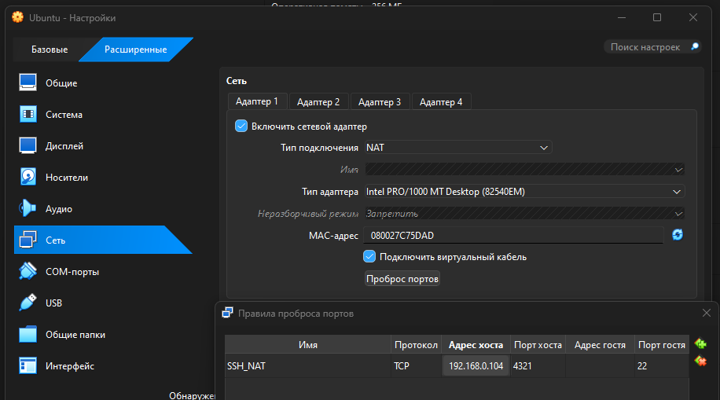
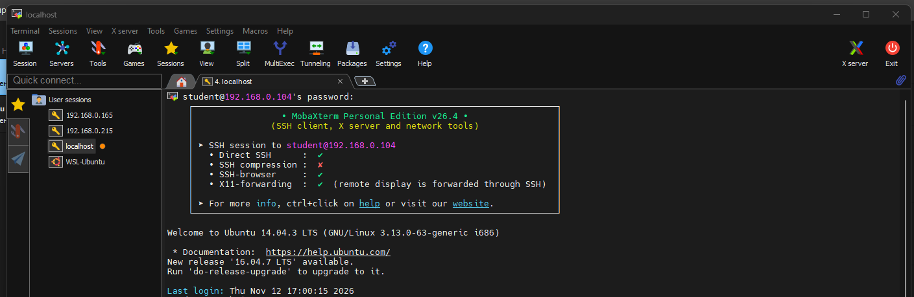
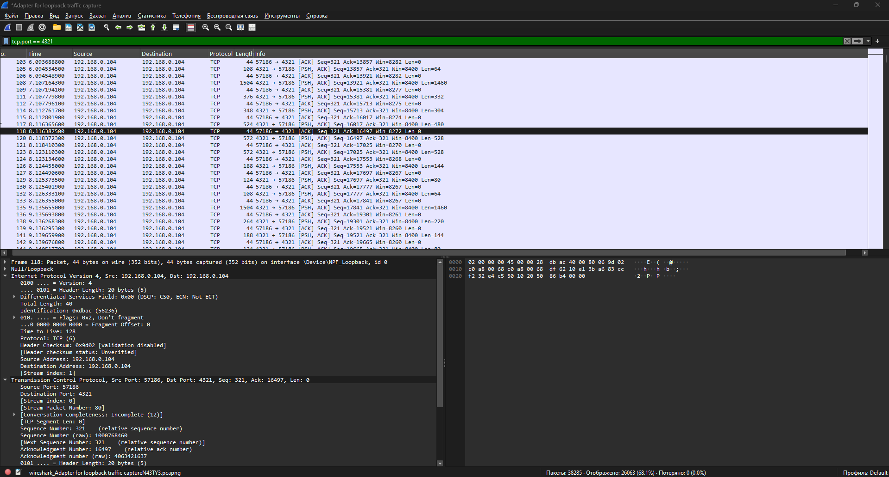
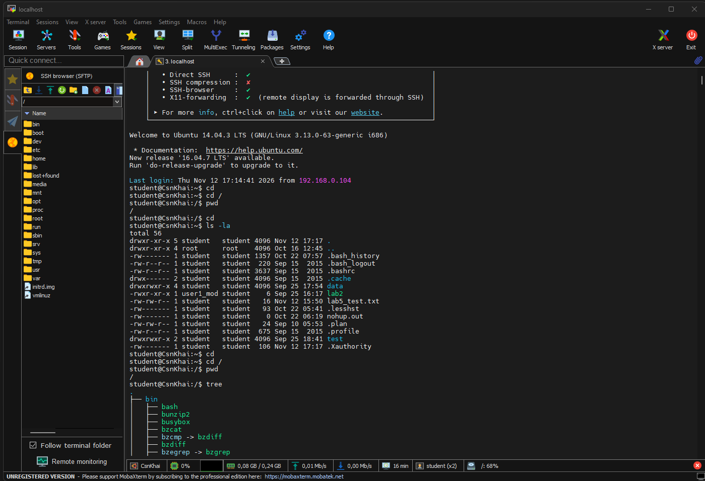

# Report on lab5

## Завдання на лабораторну роботу.

### 1. Перевірте можливість виконання найпоширеніших команд OpenSSH в операційній системі MS Windows. (Перелік команд + опис очікуваного результату + скріншоти: команда – результат).

Для перевірки базового функціоналу та команд OpenSSH-клієнта у середовищі віртуальної машини Ubuntu було виконано набір основних команд, які відповідають за перевірку версії, генерацію ключів, віддалене підключення та безпечне копіювання файлів.

1) Перевірка версії OpenSSH клієнта

За допомогою команди ssh -V перевірено встановлену версію клієнта OpenSSH та бібліотеки OpenSSL:

```
student@CsnKhai:~$ ssh -V
OpenSSH_6.6.1p1 Ubuntu-2ubuntu2.3, OpenSSL 1.0.1f 6 Jan 2014
student@CsnKhai:~$
```

Результатом є успішне виведення версії програмного забезпечення OpenSSH та OpenSSL в консоль.

2) Генерація пари криптографічних ключів (RSA)

Для налаштування безпарольної автентифікації було згенеровано пару відкритим/приватним ключем за допомогою утиліти ssh-keygen:

```
student@CsnKhai:~$ ssh-keygen -t rsa -b 2048
Generating public/private rsa key pair.
Enter file in which to save the key (/home/student/.ssh/id_rsa):
Created directory '/home/student/.ssh'.
Enter passphrase (empty for no passphrase):
Enter same passphrase again:
Your identification has been saved in /home/student/.ssh/id_rsa.
Your public key has been saved in /home/student/.ssh/id_rsa.pub.
The key fingerprint is:
fb:12:d2:4d:65:85:54:e7:b6:40:8a:25:3e:fe:6a:1b student@CsnKhai
The key's randomart image is:
+--[ RSA 2048]----+
|         . o.=o .|
|        . + *  o |
|         + + .  o|
|        . o   ...|
|       .S+     . |
|      . o.o      |
|       ..E .     |
|        .oo      |
|        .+o      |
+-----------------+
student@CsnKhai:~$
```

У результаті була створена директорія .ssh (якщо вона була відсутня) та успішна генерація закритого (id_rsa) й відкритого (id_rsa.pub) ключів із виведенням унікального відбитка (fingerprint) та графічного зображення (randomart).

3) Підключення до віддаленої віртуальної машини через SSH

Перевірено можливість інтерактивного підключення до іншої віртуальної машини в локальній мережі за її IP-адресою 192.168.0.215:

```
student@CsnKhai:~$ ssh student@192.168.0.215
The authenticity of host '192.168.0.215 (192.168.0.215)' can't be established.
ECDSA key fingerprint is d6:eb:2b:a9:bd:63:86:af:31:2f:bb:01:b5:14:63:ab.
Are you sure you want to continue connecting (yes/no)? yes
Warning: Permanently added '192.168.0.215' (ECDSA) to the list of known hosts.
student@192.168.0.215's password:
Welcome to Ubuntu 14.04.3 LTS (GNU/Linux 3.13.0-63-generic i686)

 * Documentation:  https://help.ubuntu.com/
New release '16.04.7 LTS' available.
Run 'do-release-upgrade' to upgrade to it.

Last login: Thu Nov 12 15:37:17 2026 from 192.168.0.104
student@CsnKhai:~$
```

Результатом команди є запит на додавання невідомого хоста до списку відомих (known_hosts), успішне введення пароля та відкриття захищеної сесії командного рядка на віддаленій системі.

4) Безпечне копіювання файлів за допомогою SCP

За допомогою утиліти scp створено локальний тестовий файл lab5_test.txt та передано його на віддалену віртуальну машину 192.168.0.215:

```
student@CsnKhai:~$ echo "Lab 5 test file" > lab5_test.txt
student@CsnKhai:~$ scp lab5_test.txt student@192.168.0.215:~
student@192.168.0.215's password:
lab5_test.txt                                                                                             100%   16     0.0KB/s   00:00
student@CsnKhai:~$
```

Очікуваний результат: Успішна передача файлу через зашифрований протокол SSH/SCP із відображенням шкали прогресу (100%).

5) Перевірка наявності скопійованого файлу на віддаленому сервері

Для підтвердження успішності операції копіювання було виконано підключення до цільової віртуальної машини 192.168.0.215 та переглянуто вміст домашньої директорії за допомогою команди ls -la:

```
login as: student
student@192.168.0.215's password:
    ┌──────────────────────────────────────────────────────────────────────┐
    │                 • MobaXterm Personal Edition v26.4 •                 │
    │               (SSH client, X server and network tools)               │
    │                                                                      │
    │ ⮞ SSH session to student@192.168.0.215                               │
    │   • Direct SSH      :  ✓                                             │
    │   • SSH compression :  ✗                                             │
    │   • SSH-browser     :  ✓                                             │
    │   • X11-forwarding  :  ✓  (remote display is forwarded through SSH)  │
    │                                                                      │
    │ ⮞ For more info, ctrl+click on help or visit our website.            │
    └──────────────────────────────────────────────────────────────────────┘

Welcome to Ubuntu 14.04.3 LTS (GNU/Linux 3.13.0-63-generic i686)

 * Documentation:  https://help.ubuntu.com/
New release '16.04.7 LTS' available.
Run 'do-release-upgrade' to upgrade to it.

Last login: Thu Nov 12 15:30:24 2026
student@CsnKhai:~$ ls -la
total 56
drwxr-xr-x 5 student   student 4096 Nov 12 15:50 .
drwxr-xr-x 4 root      root    4096 Oct 16 12:45 ..
-rw------- 1 student   student 1357 Oct 22 07:57 .bash_history
-rw-r--r-- 1 student   student  220 Sep 15  2015 .bash_logout
-rw-r--r-- 1 student   student 3637 Sep 15  2015 .bashrc
drwx------ 2 student   student 4096 Sep 15  2015 .cache
drwxrwxr-x 4 student   student 4096 Sep 25 17:54 data
-rwxr-xr-x 1 user1_mod student    6 Sep 25 16:17 lab2
-rw-rw-r-- 1 student   student   16 Nov 12 15:50 lab5_test.txt
-rw------- 1 student   student   93 Oct 22 05:41 .lesshst
-rw------- 1 student   student    0 Oct 22 06:19 nohup.out
-rw-rw-r-- 1 student   student   24 Sep 10 05:53 .plan
-rw-r--r-- 1 student   student  675 Sep 15  2015 .profile
drwxrwxr-x 2 student   student 4096 Sep 25 18:41 test
-rw------- 1 student   student  106 Nov 12 15:37 .Xauthority
student@CsnKhai:~$
```

Очікуваний результат: У виводі команди чітко видно файл lab5_test.txt, який було успішно передано з клієнтської машини на сервер.

---

### 2. Налаштуйте базові параметри SSH для підвищення безпеки з'єднання між клієнтом та сервером (щонайменше 3 параметри).

---

### 3. Перелічіть варіанти вибору ключів шифрування в SSH. Реалізуйте 3 з них (згенеруйте 3 різні типи ключів).

Протокол SSH підтримує різні криптографічні алгоритми для генерації пар відкритих і приватних ключів автентифікації. Основними варіантами є:
- RSA — класичний, найбільш сумісний алгоритм на основі складності факторизації великих чисел (рекомендована довжина від 2048 до 4096 біт).
- ECDSA — алгоритм цифрового підпису на основі еліптичних кривих, затверджений NIST. Забезпечує високу криптостійкість при меншому розмірі ключа.
- Ed25519 — сучасний, надзвичайно швидкий і дуже безпечний алгоритм на кривих Едвардса (Curve25519), який є поточним стандартом безпеки.
- DSA — застарілий алгоритм, який сьогодні масово вимкнено в сучасних версіях OpenSSH через вразливості.

Практична реалізація (генерація трьох типів ключів):

1) Генерація ключа RSA (4096 біт):

```
student@CsnKhai:~$ ssh-keygen -t rsa -b 4096 -f ~/.ssh/id_rsa_custom
Generating public/private rsa key pair.
Enter passphrase (empty for no passphrase):
Enter same passphrase again:
Your identification has been saved in /home/student/.ssh/id_rsa_custom.
Your public key has been saved in /home/student/.ssh/id_rsa_custom.pub.
The key fingerprint is:
8c:30:af:ba:0f:11:d0:e4:59:d3:a5:d8:8d:b9:7e:f2 student@CsnKhai
The key's randomart image is:
+--[ RSA 4096]----+
|.o. o. ..        |
| o.o +.=         |
|  + + = .        |
|   . + +         |
|  .   + S        |
|   . o           |
|  . . o .        |
|   o   +         |
|  oo.   E        |
+-----------------+
```

2) Генерація ключа ECDSA:

```
student@CsnKhai:~$ ssh-keygen -t ecdsa -b 521 -f ~/.ssh/id_rsa_ecdsa
Generating public/private ecdsa key pair.
Enter passphrase (empty for no passphrase):
Enter same passphrase again:
Your identification has been saved in /home/student/.ssh/id_rsa_ecdsa.
Your public key has been saved in /home/student/.ssh/id_rsa_ecdsa.pub.
The key fingerprint is:
08:56:aa:42:e9:87:fc:d8:7f:e2:07:10:13:45:70:2a student@CsnKhai
The key's randomart image is:
+--[ECDSA  521]---+
|   o=+.          |
|  .ooo           |
| E .*            |
|+ o+ . .         |
|.+... . S        |
| .=  .           |
| . o  .          |
|    .. o         |
|    .o+          |
+-----------------+
```

3) Генерація ключа Ed25519:

```
student@CsnKhai:~$ ssh-keygen -t ed25519 -f ~/.ssh/id_rsa_ed25519
Generating public/private ed25519 key pair.
Enter passphrase (empty for no passphrase):
Enter same passphrase again:
Your identification has been saved in /home/student/.ssh/id_rsa_ed25519.
Your public key has been saved in /home/student/.ssh/id_rsa_ed25519.pub.
The key fingerprint is:
fd:f8:97:d6:fa:22:29:81:bb:67:9c:4a:57:e5:89:ca student@CsnKhai
The key's randomart image is:
+--[ED25519  256--+
|                 |
|                 |
|              .  |
|         .   + . |
|        S.. o o  |
|        ...=     |
|        .oEo.. o |
|       ...*.o = .|
|        o= ..+.+.|
+-----------------+
student@CsnKhai:~$
```

Очікуваний результат: Успішно згенеровано три пари унікальних ключів (RSA, ECDSA, Ed25519) з різними криптографічними алгоритмами та виведено їхні відповідні відбитки (fingerprints) та графічні зображення (randomart).

---

### 4. Налаштуйте прокидання портів (port forwarding) для SSH-клієнта з хост-машини на гостьову віртуальну машину Linux, яка знаходиться за NAT.

Для налаштування доступу до віртуальної машини, яка знаходиться за мережевим екраном NAT, було виконано процедуру прокидання портів (Port Forwarding) та перевірено віддалене підключення.

1) Зміна типу мережі та налаштування прокидання портів у VirtualBox
У налаштуваннях віртуальної машини у вкладці Мережа (Network) тип підключення було змінено з «Мережевий міст» на NAT.



У додаткових параметрах NAT відкрито меню Прокидання портів (Port Forwarding) та створено правило для перенаправлення трафіку з хост-машини на гостьову систему:
- Протокол: TCP
- Адрес хоста: 192.168.0.104
- Порт хоста: 4321
- Порт гостя: 22 (стандартний порт SSH)

2) Підключення до віртуальної машини через MobaXterm

Після збереження налаштувань та запуску віртуальної машини було виконано підключення з хост-системи за допомогою SSH-клієнта MobaXterm на локальну адресу 127.0.0.1 через щойно прокинутий порт 4321.



Очікуваний результат: Успішне перенаправлення мережевого трафіку через NAT, проходження автентифікації за паролем та відкриття активного сеансу командного рядка віртуальної машини в MobaXterm.

---

### 5. Перехопіть (захопіть) трафік (за допомогою tcpdump або Wireshark) під час авторизації віддаленого клієнта на сервері через SSH, Telnet та Rlogin. Проаналізуйте отриманий результат.

Здійснити перехоплення мережевого трафіку за допомогою аналізатора пакетів Wireshark під час сеансу віддаленого підключення, порівняти рівень захищеності протоколів та довести переваги шифрування SSH над застарілими незашифрованими протоколами (Telnet, Rlogin).

1) Аналіз протоколу OpenSSH

На хост-системі Windows було запущенно аналізатор пакетів Wireshark.

У якості інтерфейсу захоплення було вибрано Adapter for loopback traffic capture, оскільки сеанс зв'язку з віртуальною машиною здійснюється через механізм прокидання портів (NAT Port Forwarding) на локальну адресу 127.0.0.1.

У верхньому полі фільтра Wireshark встановлено фільтр за новим портом підключення:

```
tcp.port == 4321
```



У сусідньому вікні термінала MobaXterm було виконано кілька тестових команд, що сформувало мережеву активність між хостом і гостьовою системою.



На основі зафіксованих даних у Wireshark можна описати такі параметри мережевої взаємодії:

Основні параметри пакету:
- Номер пакету у потоці: 118 (час захоплення 8.116387500 секунд від початку сесії).
- Розмір: 44 байти на проводі (352 біти), 44 байти захоплено. Це службовий пакет транспортного рівня.
- Мережеві адреси: Передача пакету здійснюється всередині петельки між адресами Source: 192.168.0.104 та Destination: 192.168.0.104.

Аналіз транспортного рівня (TCP):
- Порт джерела (Source Port): 57186 (динамічний порт, з якого клієнт MobaXterm встановив з'єднання).
- Порт призначення (Destination Port): 4321 (наш прокинутий порт у VirtualBox, на якому слухає SSH-сервер).

Порядкові номери та керуючі прапорці:
- Sequence Number (raw): 1000768460 (відносний номер 321).
- Acknowledgment Number (raw): 4063421637 (відносний номер 16497).
- У колонці Info та деталях пакету зафіксовано прапорець [ACK] (Acknowledgment), який підтверджує успішне отримання попередньої порції даних.

Аналіз вмісту та шифрування (Hex / Payload):
- У правій нижній панелі у шістнадцятковому (Hex) та ASCII-форматі відображено вміст сирих байтів пакету (наприклад, початкові байти заголовків 02 00 00 00 45 00...).
- У цьому та інших перехоплених пакетах корисне навантаження є зашифрованим бінарним потоком. Тут повністю відсутні будь-які відкриті текстові дані — немає ні імен користувачів, ні паролів, ні введених у консолі команд таких як pwd чи ls.

2) Порівняльний аналіз із протоколами Telnet та Rlogin

- Протокол Telnet (порт 23):

Передає всі дані у відкритому (незашифрованому) вигляді в ASCII-кодуванні.

Результат перехоплення у Wireshark (якщо б він використовувався): Усі символи логіна та пароля, що вводяться користувачем з клавіатури, чітко читаються в полі даних пакету (Plaintext), що робить цей протокол вразливим до атак типу Sniffing (прослуховування мережі).

- Протокол Rlogin (порт 513):

Аналогічно до Telnet, розроблявся у часи довірених мереж, не використовує сучасного криптографічного шифрування та передає автентифікаційні дані у відкритому вигляді.

Додатково має вразливості до спуфінгу IP-адрес, якщо налаштований на довіру за допомогою файлів .rhosts.

---

### Винсновки:

